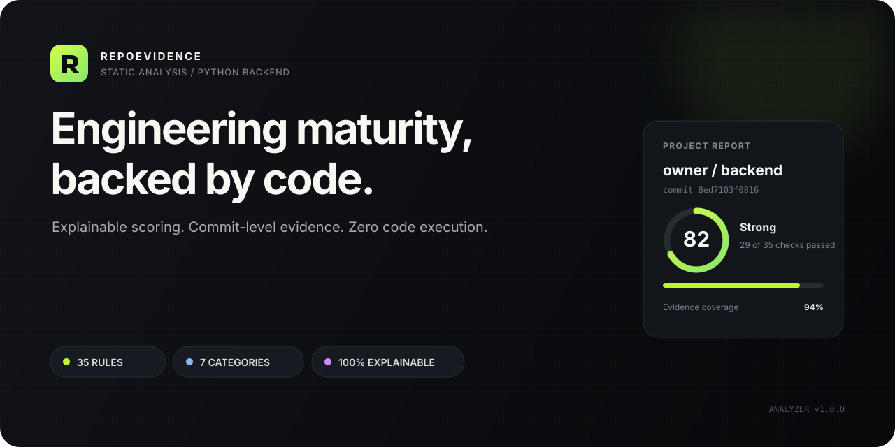
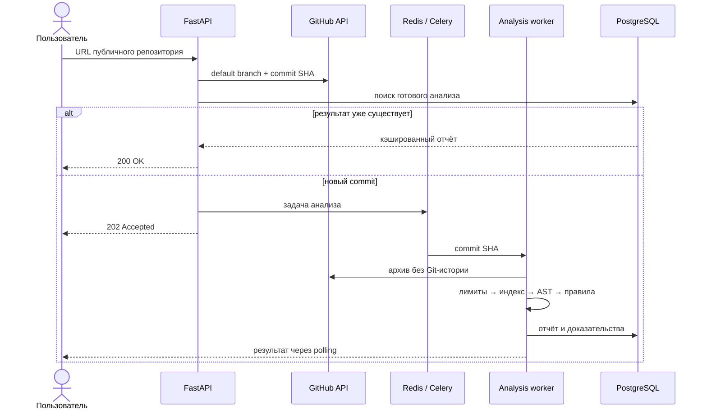

<div align="center">
  

  <br>

  <p>
    <a href="https://github.com/xeclerx/repo-evidence/actions/workflows/ci.yml"></a>
    <a href="https://www.python.org/downloads/release/python-3120/"></a>
    <a href="https://fastapi.tiangolo.com/"></a>
    <a href="https://www.postgresql.org/"></a>
    <a href="https://docs.docker.com/compose/"></a>
    <a href="LICENSE"></a>
  </p>

  <p><strong>Прозрачный статический анализ инженерной зрелости Python backend-репозиториев.</strong></p>
  <p>Каждый балл подтверждён правилом, файлом и строкой кода — без AI и без исполнения чужого проекта.</p>

  <p>
    <a href="#быстрый-запуск">Быстрый запуск</a> ·
    <a href="#как-это-работает">Как это работает</a> ·
    <a href="#api">API</a> ·
    <a href="#разработка">Разработка</a> ·
    <a href="CONTRIBUTING.md">Contributing</a>
  </p>
</div>

---

## Зачем нужен RepoEvidence

Обычный анализатор показывает нарушения по одному. RepoEvidence отвечает на более широкий вопрос: **насколько репозиторий похож на зрелый production-проект и чем это подтверждается?**

| Проблема | Что делает RepoEvidence |
|---|---|
| Оценка выглядит как «чёрный ящик» | Показывает вес, статус и объяснение каждого правила |
| Рекомендации слишком общие | Привязывает доказательства к конкретному commit, файлу и строке |
| Результат невозможно повторить | Версионирует движок и использует детерминированные проверки |
| Анализ чужого кода опасен | Загружает архив с лимитами и никогда не исполняет исходники |
| Непонятно, стал ли проект лучше | Хранит историю и сравнивает отчёты по commit SHA |

> **Текущий статус:** MVP. Поддерживаются публичные FastAPI, Django, Flask и generic Python backend-проекты.

## Возможности

- **35 версионированных проверок** по семи инженерным категориям;
- автоматическое определение FastAPI, Django, Flask или generic backend;
- единый файловый индекс и Python AST без импорта анализируемого кода;
- русскоязычный отчёт с оценкой `0–100`, уровнем зрелости и рекомендациями;
- доказательства со ссылками на GitHub, закреплёнными за commit SHA;
- идемпотентный анализ: одинаковый commit не ставится в очередь повторно;
- история репозитория и сравнение двух версий;
- отдельный Celery worker, PostgreSQL, Redis и health endpoints;
- Web UI на Jinja2 и REST API с Problem Details-ошибками.

## Быстрый запуск

Понадобятся [Docker](https://docs.docker.com/get-docker/) и Docker Compose.

```bash
git clone https://github.com/xeclerx/repo-evidence.git
cd repo-evidence
cp .env.example .env
docker compose up --build
```

Откройте:

| Сервис | Адрес |
|---|---|
| Web-интерфейс | <http://localhost:8000> |
| Swagger UI | <http://localhost:8000/docs> |
| Readiness probe | <http://localhost:8000/health/ready> |

`GITHUB_TOKEN` необязателен, но повышает лимит GitHub API. Для публичных репозиториев достаточно fine-grained token без доступа к приватным данным. Храните его только в локальном `.env` — этот файл исключён из Git.

Остановить приложение:

```bash
docker compose down
```

Удалить также локальные данные PostgreSQL:

```bash
docker compose down -v
```

## Как это работает



Исходный архив существует только во временном каталоге worker и удаляется как при успехе, так и при ошибке. В базе остаются метаданные, результаты проверок и ссылки на строки GitHub.

## Оценка

| Категория | Вес | Что проверяется |
|---|---:|---|
| Архитектура | 20 | структура, entrypoint, слои, конфигурация |
| Тестирование | 20 | тестовые модули, pytest, fixtures, async-тесты |
| Качество кода | 15 | pyproject, lint, typing, обработка ошибок |
| Безопасность | 15 | секреты, production-настройки, зависимости, опасные вызовы |
| Доставка | 15 | Docker, non-root user, Compose, CI, миграции |
| Документация | 10 | README, запуск, API, лицензия, contribution guide |
| Наблюдаемость | 5 | logging, correlation ID, liveness и readiness |

Статусы правил: `passed`, `partial`, `failed`, `not_applicable`. Неприменимые правила исключаются из знаменателя. При покрытии доказательствами ниже 60% итоговый балл не публикуется.

| Баллы | Уровень |
|---:|---|
| 0–39 | Начальный |
| 40–59 | Развивающийся |
| 60–74 | Устойчивый |
| 75–89 | Сильный |
| 90–100 | Образцовый |

## Архитектура проекта

RepoEvidence — модульный монолит со слоями `domain`, `application`, `infrastructure` и `presentation`.

```text
src/repo_evidence/
├── domain/           # сущности, статусы и правила предметной области
├── application/      # сценарии анализа и сравнения
├── analysis/         # файловый контекст, AST и реестр проверок
├── infrastructure/   # GitHub, PostgreSQL и реализации репозиториев
├── presentation/     # FastAPI, Web UI и сериализация
├── static/           # CSS и vanilla JavaScript
├── templates/        # Jinja2-шаблоны
├── worker.py         # Celery worker
└── telemetry.py      # structured logging и OpenTelemetry
```

Домен и движок анализа не зависят от FastAPI и SQLAlchemy. Архитектурное решение описано в [ADR-0001](docs/adr/0001-modular-monolith.md).

## API

Создать анализ:

```bash
curl -X POST http://localhost:8000/api/v1/analyses \
  -H "Content-Type: application/json" \
  -d '{"repository_url":"https://github.com/owner/repository"}'
```

| Метод | Endpoint | Назначение |
|---|---|---|
| `POST` | `/api/v1/analyses` | создать или получить кэшированный анализ |
| `GET` | `/api/v1/analyses/{id}` | получить состояние задачи |
| `GET` | `/api/v1/analyses/{id}/report` | получить полный отчёт |
| `GET` | `/api/v1/repositories/{owner}/{repo}/analyses` | получить историю |
| `GET` | `/api/v1/comparisons?base={id}&head={id}` | сравнить два отчёта |
| `GET` | `/health/live` | проверить процесс API |
| `GET` | `/health/ready` | проверить зависимости |

Ошибки возвращаются как `application/problem+json` со стабильным полем `code`.

## Разработка

Проект использует Python 3.12 и [uv](https://docs.astral.sh/uv/).

```powershell
uv python install 3.12
uv sync --extra dev
docker compose up postgres redis -d
uv run alembic upgrade head
uv run repo-evidence
```

Во втором терминале запустите worker:

```powershell
uv run celery -A repo_evidence.worker:celery_app worker --loglevel=INFO --pool=solo
```

Для PyCharm выберите интерпретатор `.venv\Scripts\python.exe`.

### Проверки качества

```bash
uv run ruff check .
uv run ruff format --check .
uv run mypy src
uv run pytest --cov
```

CI повторяет эти проверки с PostgreSQL и отдельно собирает Docker-образ. Локально pre-commit устанавливается командой:

```bash
uv run pre-commit install
```

## Модель безопасности

RepoEvidence:

- принимает только URL формата `https://github.com/{owner}/{repo}`;
- не поддерживает приватные репозитории в MVP;
- никогда не импортирует и не исполняет анализируемый код;
- ограничивает архив до 25 МБ, распаковку до 100 МБ и число файлов до 10 000;
- блокирует zip-slip, symlink и файлы больше 2 МБ;
- исключает `.git`, `.venv`, `node_modules`, `vendor`, `build` и `dist`;
- удаляет временные исходники после любого результата;
- не пишет исходники, токены и чувствительные заголовки в логи.

Правила ответственного раскрытия описаны в [SECURITY.md](SECURITY.md).

## Roadmap

- [x] FastAPI / Django / Flask detection
- [x] Детерминированный scoring и доказательства
- [x] История и сравнение commit SHA
- [x] Worker, PostgreSQL, Redis и Docker Compose
- [x] CI, typing, linting и тестовое покрытие
- [ ] Hosted demo
- [ ] Recruiter Mode и Team Mode
- [ ] GitHub OAuth и приватные репозитории
- [ ] Локальный CLI и plugin SDK
- [ ] Дополнительные языки

## Участие в разработке

Новые правила, bug reports и предложения приветствуются. Перед pull request прочитайте [CONTRIBUTING.md](CONTRIBUTING.md) и используйте подготовленные issue templates.

## Лицензия

Проект распространяется по лицензии [MIT](LICENSE).

<div align="center">
  <sub>Built to make backend quality visible, explainable and reproducible.</sub>
</div>
